  

  
  

## About Me

  

I'm an AI Product Manager at **HashedIn by Deloitte**, building enterprise platforms for **Consumer Loyalty** and **Insurance**. I own products from discovery to launch: framing problems with business stakeholders, writing clear PRDs, and running Agile delivery with design and engineering. My current focus is bringing GenAI into these platforms where it improves the customer experience and moves business metrics.

## Product Work & Case Studies

Click a card to expand the details.

<table>
  <tr>
    <td width="50%" valign="top">

 

<!-- WhatsApp Payments: add details below (Problem · What I did · Outcome · Link) -->
> Details coming soon.

    </td>
    <td width="50%" valign="top">

 

<!-- Solving Amazon Choice Overload: add details below (Problem · What I did · Outcome · Link) -->
>resolve the pain points

    </td>
  </tr>
  <tr>
    <td width="50%" valign="top">

 

<!-- Meesho Product Feature Analysis: add details below (Problem · What I did · Outcome · Link) -->
> Details coming soon.

    </td>
    <td width="50%" valign="top">

 

<!-- Blinkit Product Analysis: add details below (Problem · What I did · Outcome · Link) -->
> Details coming soon.

    </td>
  </tr>
  <tr>
    <td width="50%" valign="top">

 

<!-- Loyalty: add details below (Problem · What I did · Outcome · Link) -->
> Details coming soon.

    </td>
    <td width="50%" valign="top">

 

<!-- Payments: add details below (Problem · What I did · Outcome · Link) -->
> Details coming soon.

    </td>
  </tr>
  <tr>
    <td width="50%" valign="top">

 

<!-- AWS Key Learnings: add details below (Problem · What I did · Outcome · Link) -->
> Details coming soon.

    </td>
    <td width="50%" valign="top">

 

<!-- Technical Product Learnings: add details below (Problem · What I did · Outcome · Link) -->
> Details coming soon.

    </td>
  </tr>
</table>

## 🧰 Toolkit

  

  
  
  
  
  
  
  
  
  
  
  

## 📊 GitHub Pulse

  
  

## 🐍 Eating My Contributions

  <picture>
    <source media="(prefers-color-scheme: dark)" srcset="https://raw.githubusercontent.com/BhatnagarKashish/BhatnagarKashish/output/github-contribution-grid-snake-dark.gif"/>
    <source media="(prefers-color-scheme: light)" srcset="https://raw.githubusercontent.com/BhatnagarKashish/BhatnagarKashish/output/github-contribution-grid-snake.gif"/>
    
  </picture>

## 🤝 Let's Build Something

  
  

  

