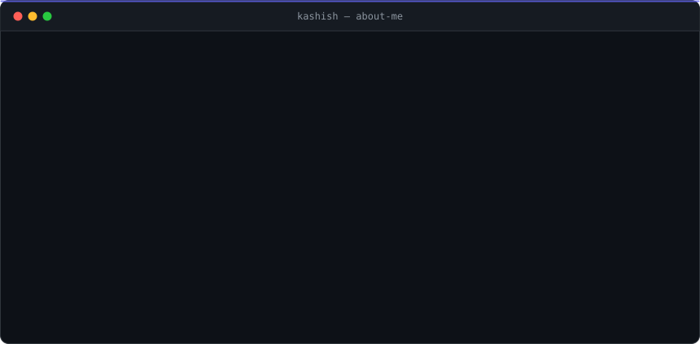

  

  
  

## About Me

  

I'm an AI Product Manager at **HashedIn by Deloitte**, building enterprise platforms for **Consumer Loyalty** and **Insurance**. I own products from discovery to launch: framing problems with business stakeholders, writing clear PRDs, and running Agile delivery with design and engineering. My current focus is bringing GenAI into these platforms where it improves the customer experience and moves business metrics.

## Product Work & Case Studies

Click any card to open the full write-up, presentations and documents.

<table>
  <tr>
    <td width="50%"></td>
    <td width="50%"></td>
  </tr>
  <tr>
    <td width="50%"></td>
    <td width="50%"></td>
  </tr>
  <tr>
    <td width="50%"></td>
    <td width="50%"></td>
  </tr>
  <tr>
    <td width="50%"></td>
    <td width="50%"></td>
  </tr>
  <tr>
    <td width="50%"></td>
    <td width="50%"></td>
  </tr>
</table>

## Toolkit

  &nbsp;
  
  
  
  

  &nbsp;
  
  
  

  &nbsp;
  
  

  &nbsp;
  

